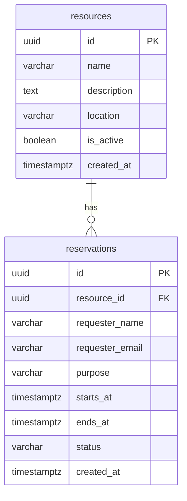

# Step 2: PostgreSQL

## Understand the relationship

A resource is something that can be booked. A reservation records who booked it and when. One resource can have many reservations. Each reservation belongs to exactly one resource through `resource_id`, a foreign key.



UUIDs identify records. TIMESTAMPTZ stores instants consistently regardless of the database session timezone. The app will display times in Asia/Colombo. Status is either `confirmed` or `cancelled`.

## Connect locally

1. Copy `.env.example` to `.env.local` in the project root.
2. Replace `REPLACE_ME` with your PostgreSQL password. This is the password chosen during PostgreSQL installation. Percent-encode special password characters, such as `%40` for `@`, `%23` for `#`, `%24` for `$`, and `%25` for `%`.
3. Keep `.env.local` private. It is ignored by Git. Do not post the password in chat.
4. Run the following from the project directory:

```powershell
npm.cmd run db:create
npm.cmd run db:migrate
npm.cmd run db:seed
npm.cmd run db:check
npm.cmd run db:test
```

The create command connects to the PostgreSQL maintenance database and creates only the application database named in the URL. It does not reset or replace an existing database. For initial local setup the configured role must have permission to create databases and the `btree_gist` extension. A hosted database may need to be provisioned through its provider instead.

## What the commands teach

- **create:** creates the application's empty database.
- **migrate:** applies versioned SQL files and records their names in `schema_migrations`. Applied files are skipped on subsequent runs; add a new migration for future schema changes.
- **seed:** adds three sample resources with stable IDs. Re-running it preserves existing rows.
- **check:** connects and lists stored resources.
- **test:** checks important database constraints inside a transaction that is rolled back, leaving no test data behind.

## Prevent double bookings

The `reservation_no_overlap` constraint compares the resource ID and booking time range. Confirmed reservations for the same resource cannot overlap, including when requests arrive concurrently. `[)` means the start is included and the end is excluded. Thus 10:00-11:00 and 11:00-12:00 are valid adjacent bookings. Cancelled bookings are excluded from the constraint.

`ON DELETE RESTRICT` preserves reservation history by preventing deletion of a resource with bookings. Use `is_active` to retire a resource instead. Future server code must additionally check active resources, future start times, and email format.

## Server connection

`src/lib/db.ts` provides a reusable connection pool using `pg`. The pool is created when first requested; it does not connect during a build. `server-only` prevents accidental imports into browser components. Database credentials must never use a `NEXT_PUBLIC_` variable.

For future queries, pass user values using parameters such as `WHERE id = $1`; never concatenate form values into SQL.
