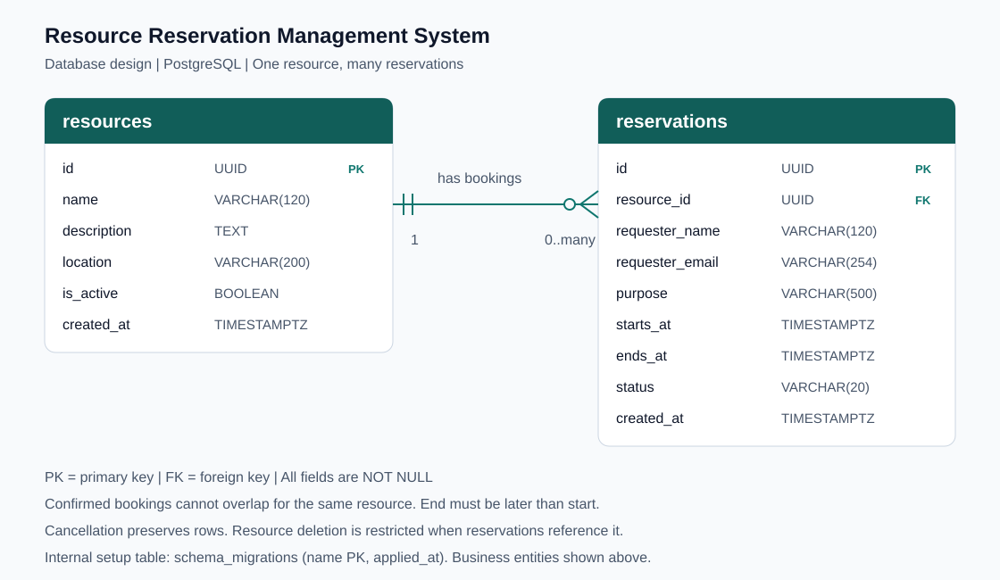
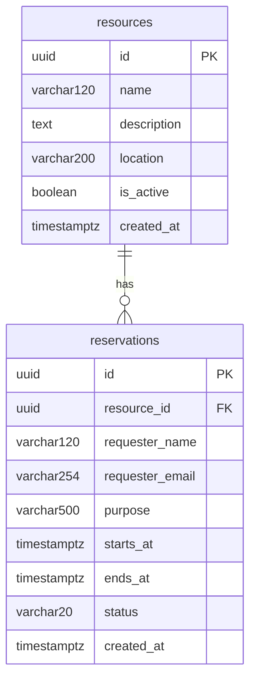

# Entity relationship diagram

One resource can have zero or more reservations. Every reservation references exactly one resource. PK means primary key; FK means foreign key. The VARCHAR suffixes specify maximum character lengths.

## Rules represented by the schema

- IDs are UUIDs generated by PostgreSQL.
- Every field is non-null; description defaults to an empty string.
- Resource `is_active` defaults to true; reservation `status` defaults to `confirmed` and permits only `confirmed` or `cancelled`.
- End must be strictly later than start.
- Confirmed time ranges for the same resource cannot overlap; adjacent ranges are allowed.
- Deleting a resource referenced by reservations is restricted.
- Timestamps use TIMESTAMPTZ; display uses Sri Lanka time.
- `created_at` defaults to the insertion time.

`schema_migrations(name TEXT PK, applied_at TIMESTAMPTZ)` is an internal migration ledger, separate from the business entities. Email syntax, future starts, and active-resource checks are enforced by server code; they are not SQL CHECK constraints.

## Sharing this diagram

After uploading the project to GitHub, open this file in the repository and copy its page URL. If the repository is private, ensure the reviewers have access; otherwise a private link alone will not let them view it. The standalone SVG can also be uploaded to a file-sharing service with viewer access for reviewers. Verify the chosen link opens for its intended audience before submitting it.

Source: `db/migrations/001_initial.sql`. Editable diagram source: `er-diagram.mmd`.
